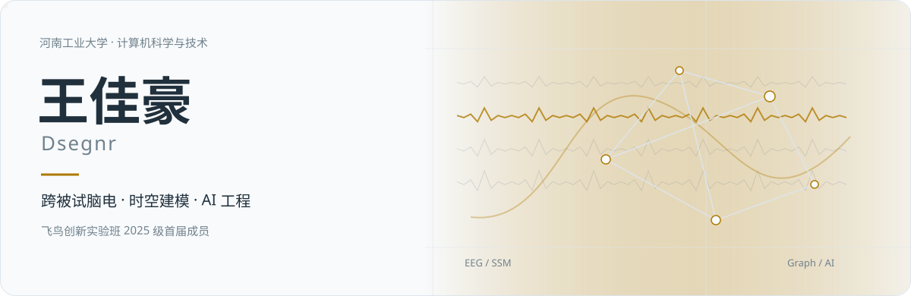
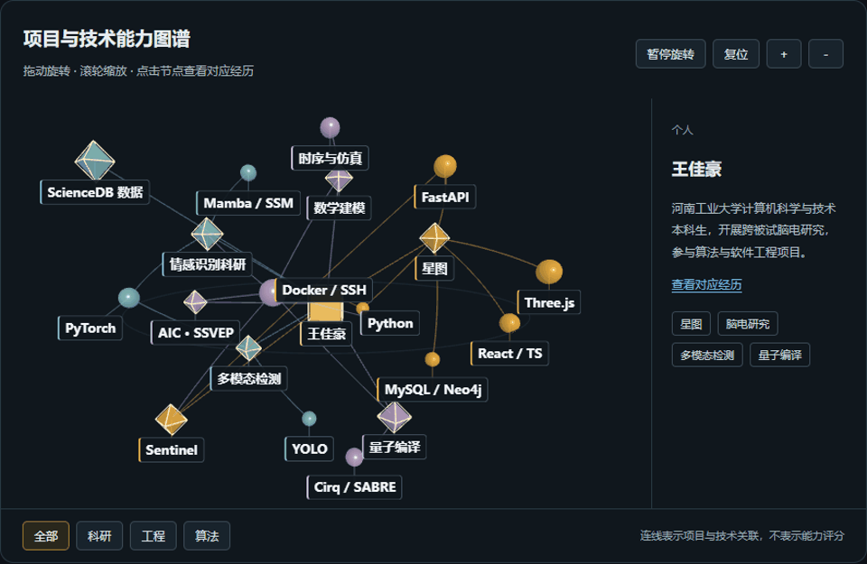

<a href="README.md">中文</a>　｜　<b>English</b>

# Jiahao Wang · Dsegnr

<picture><source media="(prefers-color-scheme: dark)" srcset="assets/header.svg"></picture>

Computer Science undergraduate at Henan University of Technology, 2025 cohort. Inaugural member of the [Feiniao Innovation Program](https://cs.haut.edu.cn/info/1421/8304.htm), [Institute of Complexity Science](https://cs.haut.edu.cn/).

[Email](mailto:3660157476@qq.com) · [Website](https://dsegnr.github.io) · [Résumé PDF](https://dsegnr.github.io/resume.pdf) · [Full résumé](https://dsegnr.github.io/resume-full.pdf)

## Profile

- <strong>Research:</strong> independent research in cross-subject EEG emotion recognition; proficient in PyTorch-based model development and experienced in applying Mamba / state space models, Transformers, and graph modeling, with skills in experimental design, model training, comparative evaluation, and scientific writing.
- <strong>Algorithms and modeling:</strong> Provincial First Prize and National Finals Third Prize in Blue Bridge Cup C/C++ University Group B; APMCM Second Prize and Huashu Cup Third Prize in the undergraduate divisions.
- <strong>Software development:</strong> development of personal-center, résumé-management, and enterprise-profile modules for Xingtu; system testing, paper experiment verification, container deployment, and database migration.

## Technical skills

- <strong>LLM application development:</strong> Familiar with LLM APIs, prompt design and structured outputs; able to develop document-parsing and information-extraction applications and validate extracted information against source documents and explicit rules.
- <strong>RAG and agents:</strong> Understanding of retrieval-augmented generation, semantic and knowledge-graph retrieval, tool calls and task planning; experience in application-module development, API integration and system validation.
- <strong>Python and data analysis:</strong> Proficient in Python, with object-oriented, asynchronous and modular programming experience; data cleaning, statistical analysis and visualization with NumPy, pandas and Matplotlib.
- <strong>Deep learning:</strong> PyTorch model implementation, training and evaluation, including memory and throughput optimization; familiarity with CNNs, Transformers, graph neural networks and Mamba / state space models for spatiotemporal modeling.
- <strong>Machine learning and optimization:</strong> Familiar with random forests, XGBoost and ARIMAX for predictive modeling and evaluation, and SHAP for interpreting feature contributions; able to build and optimize simulation models and perform quantum-circuit mapping, routing and performance evaluation with Cirq and the SABRE algorithm.
- <strong>Full-stack web development:</strong> React / TypeScript frontend, Three.js interactive 3D graphs, and FastAPI / SQLAlchemy backend development, including business modules, APIs and integration; MySQL, MongoDB and Neo4j deployment and migration experience.
- <strong>Deployment and research tools:</strong> Linux, Docker Compose, SSH and Git for container deployment, HTTPS access configuration, backups and remote GPU task management; LaTeX typesetting, Visio technical diagrams and Word documentation.

## Education

<strong>Henan University of Technology · Computer Science (Bachelor’s program)</strong> | September 2025–June 2029, expected

Inaugural member of the 2025 [Feiniao Innovation Program](https://cs.haut.edu.cn/info/1421/8304.htm), [Institute of Complexity Science](https://cs.haut.edu.cn/); mentor: Guang'en Liu.

Student activities: member of the Learning Department of the school’s 23rd Student Union; captain of Mingde College’s shot-put team for the university sports meet.

Social practice: university-organized summer community service and winter hometown outreach.

<picture><source media="(prefers-color-scheme: dark)" srcset="assets/separator.svg"></picture>

<a href="https://dsegnr.github.io/#ability-graph"><picture><source media="(prefers-reduced-motion: reduce)" srcset="assets/ability-graph-preview.png"></picture></a>

[Open the interactive graph](https://dsegnr.github.io/#ability-graph)

## Research experience

### Cross-subject EEG emotion recognition

<strong>Ongoing research | Role:</strong> independent researcher

<strong>Technologies:</strong> Python, PyTorch, Mamba / SSM, Transformers, graph representations

- Conducted research on cross-subject generalization and spatiotemporal representations, including data processing, training, evaluation, and controlled comparisons.
- Used LOSO evaluation on DEAP and SEED, maintaining configurations, archived results, and analysis records while preparing a manuscript.

## Project experience

### AIC · SSVEP EEG signal classification

<strong>Competition in progress | Role:</strong> algorithm development and evaluation

Developing an SSVEP EEG signal-classification pipeline covering signal preprocessing, feature modeling, classifier training and evaluation, with controlled comparisons, independent result checks and reproducible archives. Competition in progress.

### [Xingtu · Job-capability knowledge graph platform](https://github.com/Talent-Star-Map/XINGTU)

<strong>Team project · Competition concluded | Role:</strong> application development, validation, and deployment migration

<strong>Technologies:</strong> React, TypeScript, FastAPI, SQLAlchemy, MySQL, MongoDB, Neo4j, Docker

A platform integrating job information, capability graphs, résumé management, and job–candidate matching.

- Developed personal-center, résumé-management, and enterprise-profile modules.
- Developed an interactive 3D experience–technology graph linking résumé entries, technology nodes and source evidence, with node selection, experience filters, rotation and zoom; completed authenticated API integration and production deployment.
- Implemented LLM-based structured extraction for résumés and job descriptions, source-evidence and rule-based validation; compared information across sources and applied confidence scoring to flag skill claims unsupported by the source text.
- Prepared testing documents and contributed supplementary experiments and result verification, checking consistency across data splits, experimental records, and paper figures.
- Selected a new server and expanded its storage; deployed six containers for the frontend, API, databases, and collection service; verified database migration and configured backups and developed an SSH connection helper for the team.

[Website](https://47.120.76.16/)

### [Landslide Sentinel · Monitoring and graded warning](https://github.com/Dsegnr/landslide-sentinel-web)

<strong>Team project · data analysis, algorithms and Web development</strong>

<strong>Technologies：</strong>Python · React · TypeScript · FastAPI · SQLAlchemy · 3D visualization

- Developed monitoring-data processing, warning analysis and Web visualization; integrated device status and warning information and participated in testing and deployment.
- Published a curated Web source snapshot and demonstration. The 3D scene visualizes monitoring and terrain relationships; the related ScienceDB publication is listed separately.

[Demo (temporary tunnel; viewer login in repository)](https://substance-searched-fish-responding.trycloudflare.com)

### [Changtu Lingkong · Traffic coordination and GIS workbench](https://github.com/Dsegnr/changtu-lingkong)

<strong>Network simulation, control evaluation and workbench development · archived stage</strong>

<strong>Technologies：</strong>Python · SUMO · SuperMap GIS · React · TypeScript

- Built connected-network simulations with cross-junction vehicle tracking and trip-time measurements; compared fixed, pressure-based and joint control, including downstream capacity, spillback and per-vehicle outcomes.
- Developed map playback, phase timelines, plan comparisons and task records; implemented path isolation, hash checks, task persistence and SuperMap query adapters.
- Published frontend and portable-module source; full replay assets and third-party SDKs are not distributed. Field validation remains outstanding.

### [Urban visual multimodal object detection](https://github.com/Dsegnr/aic2026-multimodal-detection)

<strong>AIC Provincial Third Prize | Role:</strong> competition team member

<strong>Technologies:</strong> PyTorch, D-FINE, YOLO, multimodal fusion

- Participated in visible-light, infrared, and depth-based object detection, including alignment, feature fusion, and evaluation; awarded Provincial Third Prize.

### [Sentinel · Defensive security triage workbench](https://github.com/Dsegnr/sentinel-secops)

<strong>Personal project · Prototype in development | Technologies:</strong> Python, FastAPI, Jinja2, PowerShell, pytest

- Built a local CLI and Web workbench for public-source domain, URL, IP and email analysis, structured reports, SHA-256 evidence manifests, case archiving and asset/alert management.
- Implemented Windows baseline comparison and reviewable hardening scripts, with optional LLM report interpretation. Code tests cover core rules and workflows; the public repository excludes personal knowledge, cases and actual configuration.

### [Noise-adaptive quantum compiler](https://github.com/Dsegnr/ccf-quantum-compiler)

<strong>CCF Quantum Computing Programming Challenge | Role:</strong> algorithm implementation and evaluation

<strong>Technologies:</strong> Python, Cirq, SABRE, NISQ

- Implemented noise-aware routing, multiple initial layouts, and forward–backward optimization for NISQ hardware. Archived public-set score: 0.7550.

### [APMCM and Huashu Cup mathematical modeling](https://github.com/Dsegnr/math-modeling)

<strong>Undergraduate Second / Third Prize | Role:</strong> team leader

- Led modeling, algorithm implementation, result verification, and paper preparation for water-quality prediction and conductive-medium simulation optimization; archived papers, code, figures, and results.

### [Class · Class administration workspace](https://github.com/Dsegnr/Class)

<strong>Personal project · requirements, full-stack development and deployment</strong>

<strong>Technologies：</strong>React · TypeScript · FastAPI · SQLAlchemy · SQLite / MySQL

- Built task publishing, submission and review, original-file export, random selection, duty scheduling and notifications; handled requirements, frontend/backend development, testing and deployment.
- Published sanitized source with synthetic examples. The production site requires authorized access; credentials, rosters and student submissions remain private.

[Class site (authorized login required)](https://47.105.102.3/collect/)

### [Xinling · Multimodal adolescent mental-health screening platform](https://github.com/Dsegnr/xinling-mental-health)

<strong>Concept design | Role:</strong> project lead

<strong>Technologies in the proposed solution:</strong> EEG acquisition, cross-subject modeling, federated learning

- Designed the overall solution and technical roadmap and completed a 22-page project proposal.

<picture><source media="(prefers-color-scheme: dark)" srcset="assets/separator.svg"></picture>

## Research data publication

First author of the Science Data Bank dataset **Landslide monitoring data (2017–2024) and reproduction materials for a dual-timescale graded warning method at Baijiabao, Three Gorges Reservoir** (Chinese title: 三峡库区白家包滑坡2017–2024年监测数据与双时间尺度分级预警方法的复现数据与代码). V1 published October 14, 2026.

[DOI: 10.57760/sciencedb.014lj](https://doi.org/10.57760/sciencedb.014lj) · [Dataset page](https://www.scidb.cn/detail?dataSetId=7bc8827743a441cc9d881e3f7d181a16)

## Honors

- Blue Bridge Cup: Provincial First Prize and National Finals Third Prize, C/C++ University Group B | 2026
- AIC urban multimodal object-detection task: Provincial Third Prize | 2026
- APMCM: Second Prize, undergraduate division | 2026 · [Paper and code](https://github.com/Dsegnr/math-modeling/tree/main/apmcm-2026)
- Huashu Cup: Third Prize, undergraduate division | 2026 · [Paper and code](https://github.com/Dsegnr/math-modeling/tree/main/huashubei-2026)
- Challenge Cup: college-level Second Prize | 2026
- Henan University of Technology “Three Good Student” award for 2025 | May 2026

## Certificates

- CET-4: 497.
- Intermediate Industrial Internet Platform Development Engineer.

## Software copyright applications

The Copyright Protection Center of China accepted five software copyright registration applications. I am listed first on three applications and sixth on two.

- Xingtu Intelligent Résumé Parsing and Management Software V1.0 (星图智能简历解析与简历管理软件) | First-listed copyright holder | Accepted 2026-11-02
- Landslide Multisensor Fusion and Impulse-Wave Risk Estimation Software V1.0 (滑坡多传感器融合与涌浪风险估算软件) | First-listed copyright holder | Accepted 2026-11-02
- Landslide Sentinel Collaborative Sensing and Early Warning System V1.0 (边坡哨兵滑坡灾害协同感知与预警系统) | First-listed copyright holder | Accepted 2026-11-02
- Enterprise Job Capability Graph Evolution Analysis and Intelligent Matching System V1.0 (企业岗位能力图谱演化分析与智能匹配系统) | Sixth-listed copyright holder | Accepted 2026-11-02
- Intelligent Job Matching and Diagnosis System for Job Seekers V1.0 (面向求职者的智能人岗匹配与诊断系统) | Sixth-listed copyright holder | Accepted 2026-11-03

## Other competition experience

- Zhengda Cup National College Student Market Research and Analysis Competition: passed the individual knowledge test with 87 points; preparing for the team practical competition.

- AIC SSVEP EEG signal-classification task | In progress | 2026

- Group Programming Ladder Tournament (中国高校计算机大赛·团体程序设计天梯赛) | 2026 participation
- China Undergraduate Mathematical Contest in Modeling (高教社杯) | 2026 participation

## Technology stack

  <picture><source media="(prefers-color-scheme: dark)" srcset="assets/badges/python.svg"></picture>
  <picture><source media="(prefers-color-scheme: dark)" srcset="assets/badges/cpp.svg"></picture>
  <picture><source media="(prefers-color-scheme: dark)" srcset="assets/badges/pytorch.svg"></picture>
  <picture><source media="(prefers-color-scheme: dark)" srcset="assets/badges/opencv.svg"></picture>
  <picture><source media="(prefers-color-scheme: dark)" srcset="assets/badges/matlab.svg"></picture>
  <picture><source media="(prefers-color-scheme: dark)" srcset="assets/badges/fastapi.svg"></picture>
  <picture><source media="(prefers-color-scheme: dark)" srcset="assets/badges/typescript.svg"></picture>
  <picture><source media="(prefers-color-scheme: dark)" srcset="assets/badges/react.svg"></picture>
  <picture><source media="(prefers-color-scheme: dark)" srcset="assets/badges/mysql.svg"></picture>
  <picture><source media="(prefers-color-scheme: dark)" srcset="assets/badges/neo4j.svg"></picture>
  <picture><source media="(prefers-color-scheme: dark)" srcset="assets/badges/docker.svg"></picture>
  <picture><source media="(prefers-color-scheme: dark)" srcset="assets/badges/latex.svg"></picture>

## Open-source repositories

- [changtu-lingkong](https://github.com/Dsegnr/changtu-lingkong)　Changtu Lingkong · Traffic coordination and GIS workbench
- [Class](https://github.com/Dsegnr/Class)　Class · Class administration workspace

- [landslide-sentinel-web](https://github.com/Dsegnr/landslide-sentinel-web) — Landslide Sentinel Web: sensor monitoring, graded warning and 3D scenario visualization; includes a public demo and viewer login.

- [sentinel-secops](https://github.com/Dsegnr/sentinel-secops) — Local defensive-security prototype with CLI, Web workbench and tests; excludes personal knowledge and case data.

- [aic2026-multimodal-detection](https://github.com/Dsegnr/aic2026-multimodal-detection) — AIC Provincial Third Prize project: training, inference, evaluation and historical configurations.

- [<strong>Talent-Star-Map/XINGTU</strong>](https://github.com/Talent-Star-Map/XINGTU)　Xingtu job-capability knowledge graph platform; team repository, contributed as a developer.
- [<strong>math-modeling</strong>](https://github.com/Dsegnr/math-modeling)　Mathematical-modeling archive: APMCM 2026 and Huashu Cup 2026 papers, code, data and result tables.
- [<strong>ccf-quantum-compiler</strong>](https://github.com/Dsegnr/ccf-quantum-compiler)　Noise-adaptive quantum compiler for the 2026 CCF Quantum Computing Programming Challenge algorithm track; includes a 21-page technical report.
- [<strong>xinling-mental-health</strong>](https://github.com/Dsegnr/xinling-mental-health)　Xinling multimodal adolescent mental-health screening proposal, with LaTeX source and illustrations.
- [<strong>Dsegnr.github.io</strong>](https://github.com/Dsegnr/Dsegnr.github.io)　Source for the personal website and résumé.

## Milestones

<picture><source media="(prefers-color-scheme: dark)" srcset="assets/timeline.svg"></picture>

## GitHub activity

<picture><source media="(prefers-color-scheme: dark)" srcset="https://dsegnr.github.io/metrics/github-metrics.svg"></picture>
