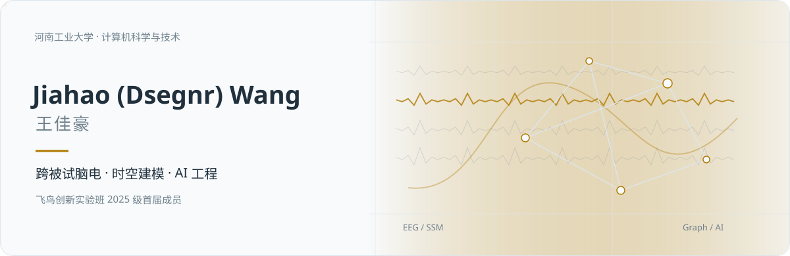
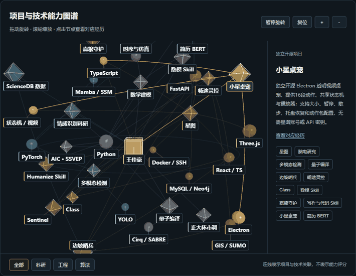
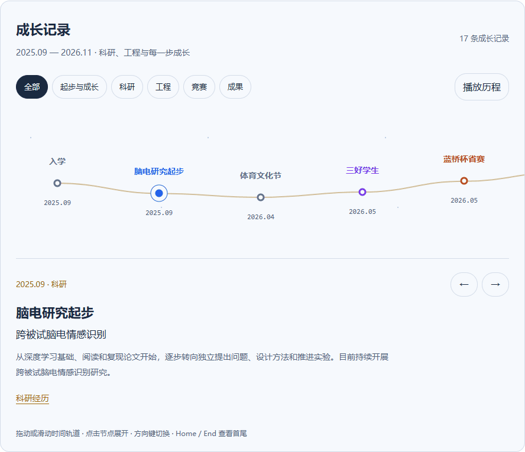

<a href="README.md">中文</a>　｜　<b>English</b>

# Jiahao (Dsegnr) Wang · 王佳豪

<picture><source media="(prefers-color-scheme: dark)" srcset="assets/header.svg"></picture>

Computer Science undergraduate at Henan University of Technology, 2025 cohort. Inaugural member of the [Feiniao Innovation Program](https://cs.haut.edu.cn/info/1421/8304.htm), [Institute of Complexity Science](https://cs.haut.edu.cn/).

[Email](mailto:3660157476@qq.com) · [Website](https://dsegnr.github.io) · [Résumé PDF](https://dsegnr.github.io/resume.pdf) · [Full résumé](https://dsegnr.github.io/resume-full.pdf) · [LinkedIn](https://www.linkedin.com/in/jiahao-wang-286b70450/)

## Profile

- <strong>Research:</strong> independent research in cross-subject EEG emotion recognition; proficient in PyTorch-based model development and experienced in applying Mamba / state space models, Transformers, and graph modeling, with skills in experimental design, model training, comparative evaluation, and scientific writing.
- <strong>Algorithms and modeling:</strong> Provincial First Prize and National Finals Third Prize in Blue Bridge Cup C/C++ University Group B; Henan Provincial First Prize in the China Undergraduate Mathematical Contest in Modeling; APMCM Second Prize and Huashu Cup National Third Prize in the undergraduate divisions.
- <strong>Software development:</strong> development of personal-center, résumé-management, and enterprise-profile modules for Xingtu; 3D experience-graph development, homepage and login interactions, system testing, paper experiment verification, deployment migration, and production releases.

## Technical skills

- <strong>LLM application development:</strong> Familiar with LLM APIs, prompt design and structured outputs; able to develop document-parsing and information-extraction applications and validate extracted information against source documents and explicit rules.
- <strong>RAG and agents:</strong> Understanding of retrieval-augmented generation, semantic and knowledge-graph retrieval, tool calls and task planning; experience in application-module development, API integration and system validation.
- <strong>Python and data analysis:</strong> Proficient in Python, with object-oriented, asynchronous and modular programming experience; data cleaning, statistical analysis and visualization with NumPy, pandas and Matplotlib.
- <strong>Deep learning:</strong> PyTorch model implementation, training and evaluation, including memory and throughput optimization; familiarity with CNNs, Transformers, graph neural networks and Mamba / state space models for spatiotemporal modeling.
- <strong>Machine learning and optimization:</strong> Familiar with random forests, XGBoost and ARIMAX for predictive modeling and evaluation, and SHAP for interpreting feature contributions; able to build and optimize simulation models and perform quantum-circuit mapping, routing and performance evaluation with Cirq and the SABRE algorithm.
- <strong>Full-stack web development:</strong> React / TypeScript frontend, Three.js interactive 3D graphs, and FastAPI / SQLAlchemy backend development, including business modules, APIs and integration; MySQL, MongoDB and Neo4j deployment and migration experience.
- <strong>Deployment and research tools:</strong> Linux, Docker Compose, SSH and Git for container deployment, HTTPS access configuration, backups and remote GPU task management; LaTeX typesetting, Visio technical diagrams and Word documentation.

## Education

<strong>Henan University of Technology · Computer Science (Bachelor’s program)</strong> | September 2025–June 2029, expected

Inaugural member of the 2025 [Feiniao Innovation Program](https://cs.haut.edu.cn/info/1421/8304.htm), [Institute of Complexity Science](https://cs.haut.edu.cn/); mentor: Guang'en Liu.

Student activities: member of the Learning Department of the school’s 23rd Student Union; captain of Mingde College’s shot-put team for the university sports meet.

Social practice: university-organized summer community service and winter hometown outreach.

<picture><source media="(prefers-color-scheme: dark)" srcset="assets/separator.svg"></picture>

<a href="https://dsegnr.github.io/#ability-graph"><picture><source media="(prefers-reduced-motion: reduce)" srcset="assets/ability-graph-preview.png"></picture></a>

[Open the interactive graph](https://dsegnr.github.io/#ability-graph)

## Research experience

### Cross-subject EEG emotion recognition

<strong>Ongoing research | Role:</strong> independent researcher

<strong>Technologies:</strong> Python, PyTorch, Mamba / SSM, Transformers, graph representations

- Conducted research on cross-subject generalization and spatiotemporal representations, including data processing, training, evaluation, and controlled comparisons.
- Used LOSO evaluation on DEAP and SEED, maintaining configurations, archived results, and analysis records while preparing a manuscript.

## Project experience

[Browse all public projects and tools](PROJECTS.md)

### AIC · SSVEP EEG signal classification

<strong>Competition in progress | Role:</strong> algorithm development and evaluation

Developing an SSVEP EEG signal-classification pipeline covering signal preprocessing, feature modeling, classifier training and evaluation, with controlled comparisons, independent result checks and reproducible archives. Competition in progress.

### [Xingtu · Job-capability knowledge graph platform](https://github.com/Talent-Star-Map/XINGTU)

<strong>Team project · Ongoing development | Role:</strong> application, 3D graph and interaction development; validation and production releases

<strong>Competition entries:</strong> Jie Bang Gua Shuai; the AI + Education track of the 3rd Xunfei Cup.

<strong>Technologies:</strong> React, TypeScript, FastAPI, SQLAlchemy, MySQL, MongoDB, Neo4j, Docker

A platform for job information, capability graphs, résumé management, and job–candidate matching. Recent team additions include AI mock interviews, PDF feedback reports, and enterprise verification workflows.

- Developed personal-center, résumé-management, and enterprise-profile modules.
- Developed an interactive 3D experience–technology graph linking résumé entries, technology nodes and source evidence, with node selection, experience filters, rotation and zoom; completed authenticated API integration and production deployment.
- Implemented LLM-based structured extraction for résumés and job descriptions, source-evidence and rule-based validation; compared information across sources and applied confidence scoring to flag skill claims unsupported by the source text.
- Prepared testing documents and contributed supplementary experiments and result verification, checking consistency across data splits, experimental records, and paper figures.
- Selected a new server and expanded its storage; deployed six containers for the frontend, API, databases, and collection service; verified database migration and configured backups and developed an SSH connection helper for the team.
- Implemented the homepage, continuous galaxy login animation, and shared brand assets across role navigation, light/dark themes, and mobile layouts; built the frontend release image, verified production assets and real logins for all three roles, and deployed with a retained rollback version.

[Website](https://47.120.76.16/)

### [Landslide Sentinel · Monitoring and graded warning](https://github.com/Dsegnr/landslide-sentinel-web)

<strong>Team project · independent software-system development</strong>

<strong>Technologies:</strong> Python · React · TypeScript · FastAPI · SQLAlchemy · 3D visualization

- Developed the frontend, backend, database and core software algorithms, covering monitoring-data processing, graded warnings, historical records and 3D visualization; handled testing and deployment. Hardware was developed by teammates.
- Published a separate Web source snapshot and demonstration guide. Third-party frameworks and upstream data retain their original attribution.

[Demonstration and local setup guide](https://github.com/Dsegnr/landslide-sentinel-web/blob/main/docs/DEMO.md)

### [Changtu Lingkong · Traffic coordination and GIS workbench](https://github.com/Dsegnr/changtu-lingkong)

<strong>Network simulation, control evaluation and workbench development · archived stage</strong>

<strong>Technologies：</strong>Python · SUMO · SuperMap GIS · React · TypeScript

- Built connected-network simulations with cross-junction vehicle tracking and trip-time measurements; compared fixed, pressure-based and joint control, including downstream capacity, spillback and per-vehicle outcomes.
- Developed map playback, phase timelines, plan comparisons and task records; implemented path isolation, hash checks, task persistence and SuperMap query adapters.
- Published frontend and portable-module source; full replay assets and third-party SDKs are not distributed. Field validation remains outstanding.

### [Urban visual multimodal object detection](https://github.com/Dsegnr/aic2026-multimodal-detection)

<strong>AIC Provincial Third Prize | Role:</strong> competition team member

<strong>Technologies:</strong> PyTorch, D-FINE, YOLO, multimodal fusion

- Participated in visible-light, infrared, and depth-based object detection, including alignment, feature fusion, and evaluation; awarded Provincial Third Prize.

### [Sentinel · Defensive security triage workbench](https://github.com/Dsegnr/sentinel-secops)

<strong>Personal project · Prototype in development | Technologies:</strong> Python, FastAPI, Jinja2, PowerShell, pytest

- Built a local CLI and Web workbench for public-source domain, URL, IP and email analysis, structured reports, SHA-256 evidence manifests, case archiving and asset/alert management.
- Implemented Windows baseline comparison and reviewable hardening scripts, with optional LLM report interpretation. Code tests cover core rules and workflows; the public repository excludes personal knowledge, cases and actual configuration.

### [Noise-adaptive quantum compiler](https://github.com/Dsegnr/ccf-quantum-compiler)

<strong>CCF Quantum Computing Programming Challenge | Role:</strong> algorithm implementation and evaluation

<strong>Technologies:</strong> Python, Cirq, SABRE, NISQ

- Implemented noise-aware routing, multiple initial layouts, and forward–backward optimization for NISQ hardware. Archived public-set score: 0.7550.

### [Mathematical modeling and tools](https://github.com/Dsegnr/math-modeling)

**Technologies:** Python, geometric localization, time-series prediction, Monte Carlo simulation, optimization.

> #### [CUMCM 2026 · Problem B](https://github.com/Dsegnr/math-modeling/tree/main/cumcm-2026)
>
> **Henan Provincial First Prize**
>
> As team leader, worked on automatic localization and removal of radio interference sources: bearing-only localization, active sensing, coverage certificates, and removal during patrol. Across six historical formal simulator runs, Problem 3 cleared 35/35 sources and Problem 4 cleared 37/37.

> #### [APMCM 2026 · Problem A](https://github.com/Dsegnr/math-modeling/tree/main/apmcm-2026)
>
> **Chinese-language event · Undergraduate Second Prize**
>
> Water-quality prediction and assessment. As team leader, handled modeling, algorithm implementation, validation and paper preparation, using time-series prediction, lag analysis and risk assessment.

> #### [Huashu Cup 2026 · Problem A](https://github.com/Dsegnr/math-modeling/tree/main/huashubei-2026)
>
> **Undergraduate National Third Prize**
>
> Conductive-medium simulation and cost optimization. As team leader, handled modeling, algorithm implementation, validation and paper preparation, combining 3D connectivity, Monte Carlo simulation and confidence intervals.

> #### [Contest workflow Skill · mcm-contest-command](https://github.com/Dsegnr/mcm-contest-command)
>
> **Independently built · Open source** | Python · SQLite · AI Skill
>
> Built an AI Skill from mathematical-modeling contest experience, covering source reading, problem selection, modeling, experiments, paper writing and submission preparation. Its Python CLI records experiments, claims, reviews and decisions in SQLite and uses file hashes to detect changes in evidence and submission materials. Includes runnable examples; all four Windows/Linux and Python 3.10/3.12 CI combinations pass.

### [Humanize and Verify · Code and writing review Skill](https://github.com/Dsegnr/humanize-and-verify)

**Independently built · Open source** | Agent Skill · Chinese / English

Built a standalone Agent Skill from software-documentation, coursework and research-writing experience. It covers code-comment cleanup, Chinese and English prose editing, and consistency checks across source code, figures and delivered files.

- Designed three modules for code, writing and artifacts, with protections for program behavior, technical facts and attribution; published installation instructions, cases and synthetic examples.

### [Class · Class administration workspace](https://github.com/Dsegnr/Class)

<strong>Personal project · requirements, full-stack development and deployment</strong>

<strong>Technologies：</strong>React · TypeScript · FastAPI · SQLAlchemy · SQLite / MySQL

- Built task publishing, submission and review, original-file export, random selection, duty scheduling and notifications; handled requirements, frontend/backend development, testing and deployment.
- Published sanitized source with synthetic examples. The production site requires authorized access; credentials, rosters and student submissions remain private.

[Class site (authorized login required)](https://47.105.102.3/collect/)

### [Xinling · Multimodal adolescent mental-health screening platform](https://github.com/Dsegnr/xinling-mental-health)

<strong>Concept design | Role:</strong> project lead

<strong>Technologies in the proposed solution:</strong> EEG acquisition, cross-subject modeling, federated learning

- Designed the overall solution and technical roadmap and completed a 22-page project proposal.

<picture><source media="(prefers-color-scheme: dark)" srcset="assets/separator.svg"></picture>

## Research data publication

First author of the Science Data Bank dataset **Landslide monitoring data (2017–2024) and reproduction materials for a dual-timescale graded warning method at Baijiabao, Three Gorges Reservoir** (Chinese title: 三峡库区白家包滑坡2017–2024年监测数据与双时间尺度分级预警方法的复现数据与代码). V1 published October 14, 2026.

[DOI: 10.57760/sciencedb.014lj](https://doi.org/10.57760/sciencedb.014lj) · [Dataset page](https://www.scidb.cn/detail?dataSetId=7bc8827743a441cc9d881e3f7d181a16)

## Honors

- China Undergraduate Mathematical Contest in Modeling (高教社杯): Henan Provincial First Prize | 2026 · [Paper and code](https://github.com/Dsegnr/math-modeling/tree/main/cumcm-2026)

- Blue Bridge Cup: Provincial First Prize and National Finals Third Prize, C/C++ University Group B | 2026
- AIC urban multimodal object-detection task: Provincial Third Prize | 2026
- APMCM (Chinese-language event): Second Prize, undergraduate division | 2026 · [Paper and code](https://github.com/Dsegnr/math-modeling/tree/main/apmcm-2026)
- Huashu Cup: National Third Prize, undergraduate division | 2026 · [Paper and code](https://github.com/Dsegnr/math-modeling/tree/main/huashubei-2026)
- Challenge Cup: college-level Second Prize | 2026
- Henan University of Technology “Three Good Student” award for 2025 | May 2026

## Certificates

- CET-4: 497.
- Intermediate Industrial Internet Platform Development Engineer.

## Software copyright applications

The Copyright Protection Center of China accepted five software copyright registration applications. I am listed first on three applications and sixth on two.

- Xingtu Intelligent Résumé Parsing and Management Software V1.0 (星图智能简历解析与简历管理软件) | First-listed copyright holder | Accepted 2026-11-02
- Landslide Multisensor Fusion and Impulse-Wave Risk Estimation Software V1.0 (滑坡多传感器融合与涌浪风险估算软件) | First-listed copyright holder | Accepted 2026-11-02
- Landslide Sentinel Collaborative Sensing and Early Warning System V1.0 (边坡哨兵滑坡灾害协同感知与预警系统) | First-listed copyright holder | Accepted 2026-11-02
- Enterprise Job Capability Graph Evolution Analysis and Intelligent Matching System V1.0 (企业岗位能力图谱演化分析与智能匹配系统) | Sixth-listed copyright holder | Accepted 2026-11-02
- Intelligent Job Matching and Diagnosis System for Job Seekers V1.0 (面向求职者的智能人岗匹配与诊断系统) | Sixth-listed copyright holder | Accepted 2026-11-03

## Other competition experience

- Zhengda Cup National College Student Market Research and Analysis Competition: passed the individual knowledge test with 87 points; preparing for the team practical competition.

- AIC SSVEP EEG signal-classification task | In progress | 2026

- Group Programming Ladder Tournament (中国高校计算机大赛·团体程序设计天梯赛) | 2026 participation

## Technology stack

  <picture><source media="(prefers-color-scheme: dark)" srcset="assets/badges/python.svg"></picture>
  <picture><source media="(prefers-color-scheme: dark)" srcset="assets/badges/cpp.svg"></picture>
  <picture><source media="(prefers-color-scheme: dark)" srcset="assets/badges/pytorch.svg"></picture>
  <picture><source media="(prefers-color-scheme: dark)" srcset="assets/badges/opencv.svg"></picture>
  <picture><source media="(prefers-color-scheme: dark)" srcset="assets/badges/matlab.svg"></picture>
  <picture><source media="(prefers-color-scheme: dark)" srcset="assets/badges/fastapi.svg"></picture>
  <picture><source media="(prefers-color-scheme: dark)" srcset="assets/badges/typescript.svg"></picture>
  <picture><source media="(prefers-color-scheme: dark)" srcset="assets/badges/react.svg"></picture>
  <picture><source media="(prefers-color-scheme: dark)" srcset="assets/badges/mysql.svg"></picture>
  <picture><source media="(prefers-color-scheme: dark)" srcset="assets/badges/neo4j.svg"></picture>
  <picture><source media="(prefers-color-scheme: dark)" srcset="assets/badges/docker.svg"></picture>
  <picture><source media="(prefers-color-scheme: dark)" srcset="assets/badges/latex.svg"></picture>

## Public repositories and works

- [**humanize-and-verify**](https://github.com/Dsegnr/humanize-and-verify)　Standalone Agent Skill for code comments, Chinese/English prose and artifact consistency review.
- [changtu-lingkong](https://github.com/Dsegnr/changtu-lingkong)　Changtu Lingkong · Traffic coordination and GIS workbench
- [Class](https://github.com/Dsegnr/Class)　Class · Class administration workspace

- [landslide-sentinel-web](https://github.com/Dsegnr/landslide-sentinel-web) — Landslide Sentinel Web: sensor monitoring, graded warning and 3D scenario visualization; includes a public demo and viewer login.

- [sentinel-secops](https://github.com/Dsegnr/sentinel-secops) — Local defensive-security prototype with CLI, Web workbench and tests; excludes personal knowledge and case data.

- [aic2026-multimodal-detection](https://github.com/Dsegnr/aic2026-multimodal-detection) — AIC Provincial Third Prize project: training, inference, evaluation and historical configurations.

- [<strong>Talent-Star-Map/XINGTU</strong>](https://github.com/Talent-Star-Map/XINGTU)　Xingtu job-capability knowledge graph platform; team repository, contributed as a developer.
- [<strong>mcm-contest-command</strong>](https://github.com/Dsegnr/mcm-contest-command)　Independently built modeling-contest AI Skill and Python CLI for evidence records, writing and submission checks.
- [<strong>math-modeling</strong>](https://github.com/Dsegnr/math-modeling)　Mathematical-modeling works: CUMCM, APMCM and Huashu Cup papers, code, data and results.
- [<strong>ccf-quantum-compiler</strong>](https://github.com/Dsegnr/ccf-quantum-compiler)　Noise-adaptive quantum compiler for the 2026 CCF Quantum Computing Programming Challenge algorithm track; includes a 21-page technical report.
- [<strong>xinling-mental-health</strong>](https://github.com/Dsegnr/xinling-mental-health)　Xinling multimodal adolescent mental-health screening proposal, with LaTeX source and illustrations.
- [<strong>Dsegnr.github.io</strong>](https://github.com/Dsegnr/Dsegnr.github.io)　Source for the personal website and résumé.

## Milestones

<a href="https://dsegnr.github.io/#growth-timeline"><picture><source media="(prefers-reduced-motion: reduce) and (prefers-color-scheme: dark)" srcset="assets/timeline-preview-dark.png"><source media="(prefers-reduced-motion: reduce)" srcset="assets/timeline-preview-light.png"><source media="(prefers-color-scheme: dark)" srcset="assets/timeline-preview-dark.gif"></picture></a>

[Open the interactive timeline](https://dsegnr.github.io/#growth-timeline) · Filters, milestone details, and playback

## GitHub activity

<picture><source media="(prefers-color-scheme: dark)" srcset="https://dsegnr.github.io/metrics/github-metrics.svg"></picture>
