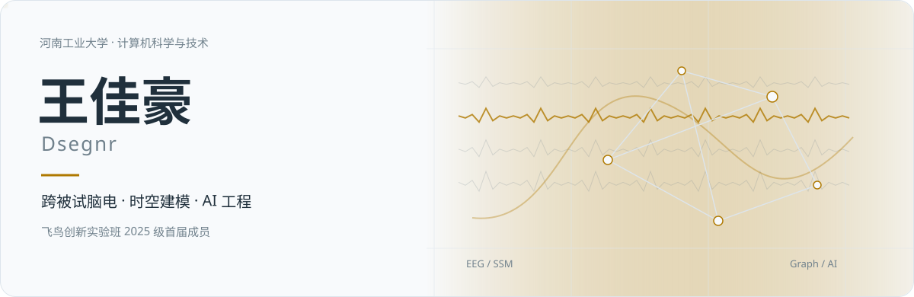
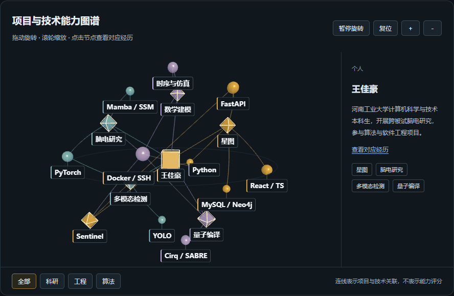

<b>中文</b>　｜　<a href="README.en.md">English</a>

<picture><source media="(prefers-color-scheme: dark)" srcset="assets/header.svg"></picture>

<h3 align="center">跨被试脑电情感识别 · 多模态视觉感知 · 人工智能应用</h3>

  <a href="mailto:3660157476@qq.com"><picture><source media="(prefers-color-scheme: dark)" srcset="https://cdn.jsdelivr.net/gh/Dsegnr/Dsegnr@main/assets/badges/email.svg"></picture></a>
  <a href="https://dsegnr.github.io"><picture><source media="(prefers-color-scheme: dark)" srcset="https://cdn.jsdelivr.net/gh/Dsegnr/Dsegnr@main/assets/badges/homepage.svg"></picture></a>
  <a href="https://dsegnr.github.io/resume.pdf"><picture><source media="(prefers-color-scheme: dark)" srcset="https://cdn.jsdelivr.net/gh/Dsegnr/Dsegnr@main/assets/badges/resume.svg"></picture></a>
  <a href="https://github.com/Dsegnr"><picture><source media="(prefers-color-scheme: dark)" srcset="https://cdn.jsdelivr.net/gh/Dsegnr/Dsegnr@main/assets/badges/github.svg"></picture></a>

<a href="#个人概述">个人概述</a> · <a href="#专业技能">专业技能</a> · <a href="#项目经历">项目经历</a> · <a href="#竞赛与荣誉">竞赛与荣誉</a>

河南工业大学计算机科学与技术 2025 级本科生，[复杂性科学研究院](https://cs.haut.edu.cn/)「[飞鸟创新实验班](https://cs.haut.edu.cn/info/1421/8304.htm)」2025 级首届成员。

## 个人概述

- <strong>科研实践：</strong>围绕跨被试脑电情感识别开展独立研究，使用 PyTorch、Mamba／状态空间模型、Transformer 及图结构建模技术，具备实验设计、模型训练、对照分析与科研写作经验。
- <strong>算法与建模：</strong>蓝桥杯 C/C++ 大学 B 组河南赛区一等奖、全国总决赛三等奖；APMCM 本科组二等奖、华数杯本科生组三等奖；具有数学建模、算法实现与实验评测经验。
- <strong>软件开发：</strong>参与星图岗位能力图谱平台开发，承担个人中心、简历管理与企业信息模块，以及系统测试、论文实验复核、容器部署和数据库迁移工作。

## 专业技能

- <strong>大模型应用开发：</strong>熟悉大模型 API 调用、提示词设计与结构化输出，能够开发文档解析和信息抽取类应用，并通过原文比对与规则校验检查抽取结果的准确性。
- <strong>RAG 与 Agent：</strong>了解 RAG（检索增强生成）、语义检索、知识图谱检索及 Agent 工具调用与任务规划流程；具备相关应用的业务模块开发经验，能够完成接口联调与系统功能验证。
- <strong>Python 与数据分析：</strong>熟练掌握 Python，熟悉面向对象、异步编程与模块化开发；能够基于 NumPy、pandas 和 Matplotlib 完成数据清洗、统计分析与可视化。
- <strong>深度学习：</strong>掌握基于 PyTorch 的模型构建、训练与评估方法，具有降低显存占用、提升训练吞吐量的优化经验；熟悉 CNN、Transformer、图神经网络及 Mamba／状态空间模型在时空建模中的应用。
- <strong>机器学习与优化：</strong>熟悉随机森林、XGBoost 与 ARIMAX，能够完成预测模型构建与评估，并通过 SHAP 分析特征对预测结果的影响；具备仿真建模与优化能力，能够基于 Cirq 和 SABRE 算法完成量子线路映射、路由与性能评测。
- <strong>Web 全栈开发：</strong>熟悉 React、TypeScript、FastAPI 与 SQLAlchemy，具备前后端开发能力，能够完成业务模块设计、接口开发与联调；熟悉 MySQL、MongoDB、Neo4j，具有数据库部署与数据迁移经验。
- <strong>部署与科研工具：</strong>熟悉 Linux、Docker Compose、SSH 和 Git，能够完成容器化部署、数据备份与远端 GPU 任务管理；能够运用 LaTeX、Visio 和 Word 完成论文排版、技术制图与文档编写。

<picture><source media="(prefers-color-scheme: dark)" srcset="assets/separator.svg"></picture>

## 教育背景

<strong>河南工业大学　计算机科学与技术（本科）｜2025.09—2029.06（预计）</strong>

[复杂性科学研究院](https://cs.haut.edu.cn/)「[飞鸟创新实验班](https://cs.haut.edu.cn/info/1421/8304.htm)」2025 级首届成员，导师刘广恩。

学生工作：信息学院第二十三届学生会学习部成员；明德书院校运会铅球队队长。

社会实践：学校组织的暑期“三下乡”与寒假返乡宣传。

<picture><source media="(prefers-color-scheme: dark)" srcset="assets/separator.svg"></picture>

<a href="https://dsegnr.github.io/#ability-graph"><picture><source media="(prefers-reduced-motion: reduce)" srcset="assets/ability-graph-preview.png"></picture></a>

[打开交互版图谱](https://dsegnr.github.io/#ability-graph) · 支持旋转、缩放与节点选择

## 项目经历

### [星图 · 岗位能力图谱动态演化与分析系统](https://github.com/Talent-Star-Map/XINGTU)

<strong>团队项目</strong>　｜　<strong>角色：</strong>业务模块开发、系统验证与部署迁移

<strong>技术栈：</strong>React · TypeScript · FastAPI · SQLAlchemy · MySQL · MongoDB · Neo4j · Docker

面向岗位技能分析与人岗匹配，构建集岗位信息、能力图谱、简历管理和匹配分析于一体的平台。

- 负责求职端个人中心、简历管理及企业信息相关模块开发。
- 在简历与岗位描述解析中实现大模型结构化信息抽取、原文证据校验及规则兜底，结合交叉验证与置信度评分约束无证据技能输出。
- 承担测试文档编制、论文补实验与结果复核，核对数据划分、实验记录及论文图表的一致性。
- 完成新服务器选型与存储扩容，部署前端、后端、三类数据库和采集程序共 6 个容器；完成数据库迁移核验、备份配置与团队自动 SSH 连接工具。

### 跨被试脑电情感识别

<strong>科研进行中</strong>　｜　<strong>角色：</strong>独立研究

<strong>技术栈：</strong>Python · PyTorch · Mamba / SSM · Transformer · 图结构建模

面向脑电情感识别中的跨被试泛化问题，开展深度时空特征建模研究。

- 使用状态空间模型、注意力机制与图结构建模技术开展研究，完成数据处理、训练评估及对照实验。
- 在 DEAP、SEED 数据集上开展 LOSO 跨被试评估，维护实验配置、结果归档与分析记录，推进论文撰写。

### [城市场景视觉多模态目标检测](https://github.com/Dsegnr/aic2026-multimodal-detection)

<strong>AIC 省赛三等奖</strong>　｜　<strong>角色：</strong>参赛成员

<strong>技术栈：</strong>PyTorch · D-FINE · YOLO · 多模态融合

全球校园人工智能算法精英大赛“面向城市场景的视觉多模态目标检测”赛题项目。

- 围绕可见光、红外与深度信息开展多模态目标检测实践，涉及数据对齐、特征融合及模型评测；获省赛三等奖。

### [Sentinel · 安全研判与防御工作台](https://github.com/Dsegnr/sentinel-secops)

<strong>个人项目 · 原型持续完善中</strong>　｜　<strong>技术栈：</strong>Python · FastAPI · Jinja2 · PowerShell · pytest

面向个人与小团队的本地安全研判工具原型，提供命令行和 Web 工作台，串联公开情报查询、证据报告、主机基线检查及发现管理。

- 实现域名／URL、IP 与邮件分析，结构化报告及 SHA-256 证据清单、案件归档、资产与告警管理；提供 Windows 基线差异和可审阅的加固脚本，接入可选 LLM 报告解释。
- 已有公开代码测试覆盖研判规则、证据导出、基线及告警流程；公开版本不包含个人知识库、案件或实际配置。

### [噪声自适应量子编译器](https://github.com/Dsegnr/ccf-quantum-compiler)

<strong>CCF 量旋杯 · 算法赛道</strong>　｜　<strong>角色：</strong>算法实现与评测

<strong>技术栈：</strong>Python · Cirq · SABRE · NISQ

基于 SABRE 映射算法，面向 NISQ 硬件开展量子线路布局与路由的噪声自适应优化。

- 实现噪声感知路由、多策略初始布局与正反向交替优化；公开题评测综合评分 0.7550，相对发布包中的最优 baseline 提升 8.3%。

### [APMCM 与华数杯数学建模](https://github.com/Dsegnr/math-modeling)

<strong>本科组二等奖 / 三等奖</strong>　｜　<strong>角色：</strong>队长

<strong>技术栈：</strong>Python · 时序建模 · 仿真优化 · 数据分析

分别研究水质预测与评估、导电介质仿真优化问题。

- 负责问题建模、算法实现、结果验证与论文组织，归档论文、程序、图表及结果；分别获 APMCM 本科组二等奖和华数杯本科生组三等奖。

### [心聆 · 青少年心理健康多模态智能筛查平台](https://github.com/Dsegnr/xinling-mental-health)

<strong>方案设计</strong>　｜　<strong>角色：</strong>项目负责人

<strong>技术栈：</strong>脑电采集 · 跨被试建模 · 联邦学习

面向青少年心理健康筛查需求，设计多模态智能筛查平台方案。

- 负责项目整体方案与技术路线设计，完成 22 页项目计划书。

<picture><source media="(prefers-color-scheme: dark)" srcset="assets/separator.svg"></picture>

## 竞赛与荣誉

- 蓝桥杯全国软件和信息技术专业人才大赛：C/C++ 程序设计大学 B 组河南赛区一等奖、全国总决赛三等奖｜2026
- 全球校园人工智能算法精英大赛（AIC）：省赛三等奖｜2026
- APMCM 亚太地区大学生数学建模竞赛：本科组二等奖｜2026　（[论文与代码](https://github.com/Dsegnr/math-modeling/tree/main/apmcm-2026)）
- “华数杯”全国大学生数学建模竞赛：本科生组三等奖｜2026　（[论文与代码](https://github.com/Dsegnr/math-modeling/tree/main/huashubei-2026)）
- “挑战杯”院赛二等奖｜2026
- 河南工业大学 2025 年度“三好学生”｜2026.05

## 证书

- 全国大学英语四级（CET-4）：497 分。
- 工业互联网平台开发工程师（中级）。

## 软件著作权

申请中，均列<strong>第一著作权人</strong>：

- 边坡哨兵滑坡灾害协同感知与预警系统 V1.0
- 滑坡多传感器融合与涌浪风险估算软件 V1.0
- 星图智能简历解析与简历管理软件 V1.0

## 其他参赛经历

- 中国高校计算机大赛 · 团体程序设计天梯赛｜2026 参赛经历
- 全国大学生数学建模竞赛（高教社杯）｜2026 参赛经历

## 技术栈

  <picture><source media="(prefers-color-scheme: dark)" srcset="https://cdn.jsdelivr.net/gh/Dsegnr/Dsegnr@main/assets/badges/python.svg"></picture>
  <picture><source media="(prefers-color-scheme: dark)" srcset="https://cdn.jsdelivr.net/gh/Dsegnr/Dsegnr@main/assets/badges/cpp.svg"></picture>
  <picture><source media="(prefers-color-scheme: dark)" srcset="https://cdn.jsdelivr.net/gh/Dsegnr/Dsegnr@main/assets/badges/pytorch.svg"></picture>
  <picture><source media="(prefers-color-scheme: dark)" srcset="https://cdn.jsdelivr.net/gh/Dsegnr/Dsegnr@main/assets/badges/opencv.svg"></picture>
  <picture><source media="(prefers-color-scheme: dark)" srcset="https://cdn.jsdelivr.net/gh/Dsegnr/Dsegnr@main/assets/badges/matlab.svg"></picture>
  <picture><source media="(prefers-color-scheme: dark)" srcset="https://cdn.jsdelivr.net/gh/Dsegnr/Dsegnr@main/assets/badges/fastapi.svg"></picture>
  <picture><source media="(prefers-color-scheme: dark)" srcset="https://cdn.jsdelivr.net/gh/Dsegnr/Dsegnr@main/assets/badges/typescript.svg"></picture>
  <picture><source media="(prefers-color-scheme: dark)" srcset="https://cdn.jsdelivr.net/gh/Dsegnr/Dsegnr@main/assets/badges/react.svg"></picture>
  <picture><source media="(prefers-color-scheme: dark)" srcset="https://cdn.jsdelivr.net/gh/Dsegnr/Dsegnr@main/assets/badges/mysql.svg"></picture>
  <picture><source media="(prefers-color-scheme: dark)" srcset="https://cdn.jsdelivr.net/gh/Dsegnr/Dsegnr@main/assets/badges/neo4j.svg"></picture>
  <picture><source media="(prefers-color-scheme: dark)" srcset="https://cdn.jsdelivr.net/gh/Dsegnr/Dsegnr@main/assets/badges/docker.svg"></picture>
  <picture><source media="(prefers-color-scheme: dark)" srcset="https://cdn.jsdelivr.net/gh/Dsegnr/Dsegnr@main/assets/badges/latex.svg"></picture>

## 开源仓库

- [sentinel-secops](https://github.com/Dsegnr/sentinel-secops)　Sentinel 本地安全研判与防御工具原型，包含 CLI、Web 工作台与测试，不含知识库和案件数据

- [aic2026-multimodal-detection](https://github.com/Dsegnr/aic2026-multimodal-detection)　AIC 省赛三等奖项目，包含训练、推理、评测与历史实验配置

- [<strong>Talent-Star-Map/XINGTU</strong>](https://github.com/Talent-Star-Map/XINGTU)　星图 · 岗位能力图谱动态演化与分析系统（团队仓库，本人为开发者之一）
- [<strong>math-modeling</strong>](https://github.com/Dsegnr/math-modeling)　数学建模竞赛作品存档：APMCM 2026 与华数杯 2026 的论文、代码、数据与结果表
- [<strong>ccf-quantum-compiler</strong>](https://github.com/Dsegnr/ccf-quantum-compiler)　噪声自适应量子编译器（2026 CCF 量旋杯 · 算法赛道，含 21 页作品说明文档）
- [<strong>xinling-mental-health</strong>](https://github.com/Dsegnr/xinling-mental-health)　心聆 · 青少年心理健康多模态智能筛查平台（项目计划书、LaTeX 源码与配图）
- [<strong>Dsegnr.github.io</strong>](https://github.com/Dsegnr/Dsegnr.github.io)　本主页与简历的源码

## 成长记录

<picture><source media="(prefers-color-scheme: dark)" srcset="assets/timeline.svg"></picture>

## GitHub 数据

<picture><source media="(prefers-color-scheme: dark)" srcset="https://dsegnr.github.io/metrics/github-metrics.svg"></picture>
